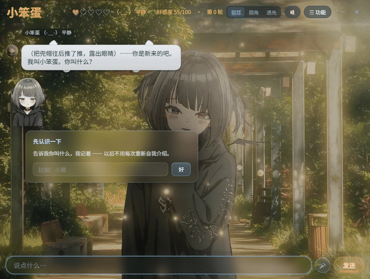
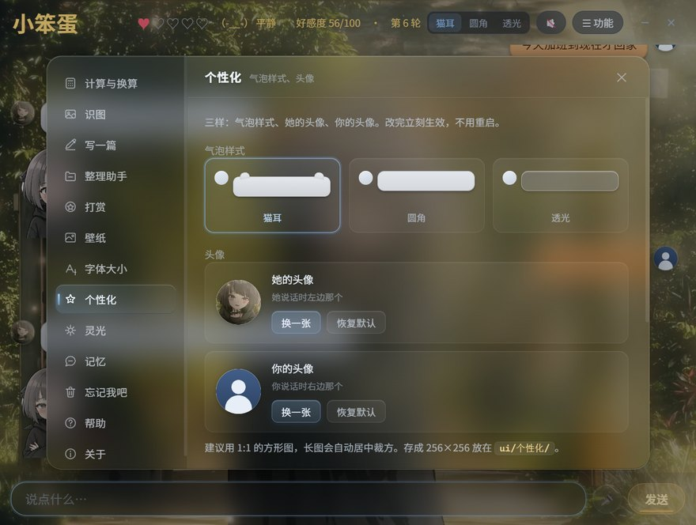
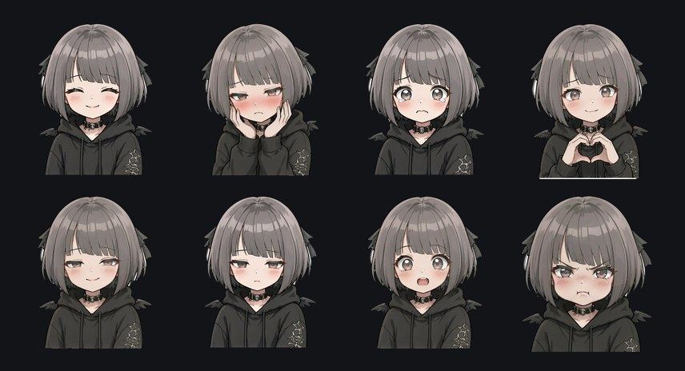

<div align="center">

# 小笨蛋

[](https://github.com/Peijy1226/xiaobendan-ai-v2.0.0/releases)
[](LICENSE)
[](#)
[](#)
[](#)


**她叫小笨蛋。十八岁，银灰短发，兜帽罩着，住在你的电脑里。**

**不是助手，不是机器人。打开电脑，她就过来陪你说几句话。**

[下载](https://github.com/Peijy1226/xiaobendan-ai-v2.0.0/releases) · [功能](#功能) · [开发文档](#开发文档) · [English](README_EN.md)

</div>

---

## 预览



## 简介

小笨蛋是一个 Windows 桌面陪伴程序。启动后常驻系统托盘，可随时呼出对话窗口；关闭窗口不会退出进程，她会继续在后台待着，隔一段时间主动说一句话。

程序内置 515 句离线语料，不联网即可完成报时、算术、笑话、图像识别、文件整理等任务。配置 DeepSeek API 密钥后具备完整的自然语言对话能力。

## 核心能力

| 模块 | 说明 |
|---|---|
| **对话** | 联网调用大模型；无密钥时自动降级至本地语料库 |
| **长期记忆** | 记录姓名、宠物、偏好、职业、城市等信息，跨会话保留 |
| **主动消息** | 长时间无交互后主动发言；窗口隐藏时以系统通知形式推送 |
| **语音合成** | 基于 edge-tts，按标点切分音频流，首段播放延迟低于 1 秒 |
| **语音识别** | 基于 Vosk 中文模型，完全本地运行，音频不上传 |
| **图像识别** | OCR 文字提取、人脸检测、物体检测，大图自动降采样 |
| **文本生成** | 记叙、议论、说明、书信四类文体，按目标字数调整提示词 |
| **文件整理** | 按扩展名分类归档，白名单外的目录不受影响 |
| **壁纸** | 支持静态图片与视频壁纸 |
| **界面** | 三套气泡样式、字号 12–20、面板模糊度四档可调 |

## 界面

小笨蛋提供三套气泡样式与独立的界面调节面板。以下为个性化设置页：



磨砂气泡使用原生 `backdrop-filter`，壁纸移动时背景同步变化，并非静态贴图。

**可调参数**

| 参数 | 取值范围 | 默认值 |
|---|---|---|
| 模糊 | 0 – 80 px | 22 px |
| 色彩浓度 | 1.0 – 2.0 | 1.26 |
| 亮度 | 0.70 – 1.40 | 1.12 |
| 底色不透明度 | 0 – 0.80 | 0.26 |

调节实时生效，松手后写入 `ui/个性化/玻璃.txt`。默认值基于帮助页文字的实测对比度选定：面板透明度 5.8，文字对比度 20,271。

## 情绪与表情

内置 29 张表情，按当前情绪状态调度。每条回复根据心情选取对应素材，离线与联网模式下均可使用。



## 安装

从 [Releases](https://github.com/Peijy1226/xiaobendan-ai-v2.0.0/releases) 下载 `xiaobendan-v2.0.0-win64.zip`，解压后双击 `小笨蛋.exe`。

- 无需安装 Python 或任何运行库
- 解压后约 415 MB
- 首次启动会引导填写名称

## 配置 API 密钥（可选）

未配置密钥时程序以离线模式运行，覆盖报时、算术、笑话、图像识别、文件整理等功能。如需完整对话能力：

1. 访问 [platform.deepseek.com](https://platform.deepseek.com) 注册并创建 API Key
2. 将仓库中的 `API.示例.txt` 复制为 `ui/API.txt`
3. 在 `钥匙=` 后填写密钥，保存后重启程序

费用约为每千条消息数角人民币。

> `ui/API.txt` 已列入 `.gitignore`，不会被提交。

## 技术栈

| 层 | 技术 |
|---|---|
| 界面 | 原生 HTML / CSS / JavaScript + WebView2 |
| 窗口 | pywebview 6.2，自绘标题栏 + DWM 系统圆角 |
| 图像 | OpenCV 5 + onnxruntime + RapidOCR |
| 语音合成 | edge-tts |
| 语音识别 | Vosk 中文小模型（42 MB，本地运行） |
| 托盘 | pystray |
| 打包 | PyInstaller |

选用 WebView2 而非 Electron：Electron 运行时约 150 MB，而本程序的体积主要来自模型与 OpenCV；WebView2 为 Windows 系统组件，不额外占用空间。

---

# 开发文档

## 目录结构

```
main.py              程序入口：窗口、DWM 圆角、托盘、主动消息定时器
api.py               前后端桥接，53 个方法
core/
  luoji.py           逻辑层，约 7,700 行：对话、情绪、记忆、壁纸
  shitu.py           图像识别：OCR、人脸、物体
  zhengli.py         文件整理
  xiezuo.py          文本生成
  dashang.py         打赏页
  tuopan.py          系统托盘
  zhu_dong.py        主动消息与系统通知
  yuyin_shuru.py     语音输入（Vosk）
  models/            onnx 模型（不纳入版本控制，运行 下载模型.py 获取）
ui/
  index.html
  css/               base / titlebar / chat / input / gongneng
  js/                bridge / bishu / chat / gongneng / input
                     / yuyin（语音合成）/ yuyin_shuru（语音输入）
  素材/              壁纸、图标、示例素材
  表情/              29 张表情素材
  语料/              515 句离线语料
  个性化/            头像、气泡偏好
  人设.txt           角色设定
  API.txt            API 密钥（已列入 .gitignore）
下载模型.py
打包.spec
```

三层结构：页面（HTML/CSS/JS）→ 桥接层（`api.py` 中每个方法对应前端一个 `Qiao.xxx()`）→ 逻辑层（`core/luoji.py`）。

## 本地运行

```bash
pip install -r requirements.txt
python 下载模型.py
python main.py
```

启动参数：`--debug` 开启开发者工具，`--自检` 不开窗口仅输出环境报告。

`vendor/` 目录用于单独安装 pystray、sounddevice、vosk，以保持系统 site-packages 干净。该目录非必需，代码在两个位置都会查找。如需使用：

```bash
pip install --target vendor pystray sounddevice vosk srt requests tqdm
```

## 打包

```bash
python -m PyInstaller 打包.spec --noconfirm
```

输出约 416 MB，其中绝大部分为第三方依赖：

| 组件 | 体积 |
|---|---|
| OpenCV（`cv2.pyd`） | 82 MB |
| Vosk 中文模型 | 66 MB |
| yolox onnx 模型 | 35 MB |

程序自身代码不足 1 MB。

打包后需手动执行 `cp -r ui dist/小笨蛋/`。`ui` 目录不与 exe 打包在一起，以便用户自行更换壁纸与表情。

## 定制

**角色设定** — 修改 `ui/人设.txt`，重启生效。该文件定义角色身份、说话风格、回避话题及未知问题的处理方式，提示词由该文件拼装生成。

**离线语料** — `ui/语料/*.txt`，每行一句。启动时全部载入内存，现有 515 句仅占数十 KB。

**表情素材** — `ui/表情/灵光/` 与 `ui/表情/离线/`，文件名为情绪标识（平静、开心、兴奋、得意、委屈、困惑、关心）。新增文件会被自动识别，缺失则不显示。

**壁纸** — 放入 `ui/素材/壁纸/`。

---

## 许可

MIT
