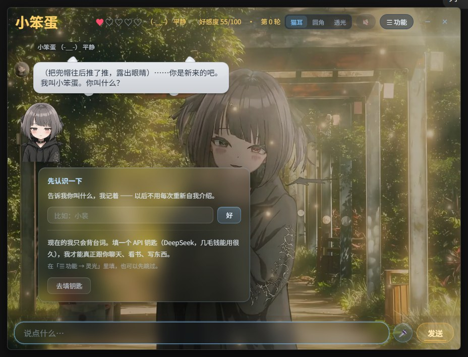

# 小笨蛋

<p align="center">
  
</p>

<p align="center">
  一个住在你电脑里的陪伴型 AI · Windows 桌面程序
</p>

<p align="center">
  
  
  
</p>

<p align="center">
  
</p>

---

## 这是什么

不是助手，不是工具箱。是一个**会记得你**的桌面角色。

打开它，她会问你叫什么。之后她记着你的名字、你养的猫、你讨厌早起。
一阵子没聊天，她会自己冒一句。你按住麦克风说话，她听得见。
你关窗口，她躲到右下角托盘里，不占地方但还在。

不联网也能用 —— 内置 515 句语料，报时、算数、讲笑话、识图、整理文件都能跑。
填一个 API 钥匙，她才会真的聊天。

---

## 快速开始

### 方式一：下载成品（不用装 Python）

去 [Releases](../../releases) 下最新的 `小笨蛋-vX.X.X-win64.zip`，
解压，双击 `小笨蛋.exe`。

### 方式二：从源码跑

```bash
git clone <本仓库地址>
cd 小笨蛋

# 1. 装依赖
pip install -r requirements.txt

# 2. 下模型（约 80 MB，识图 + 语音）
python 下载模型.py

# 3. 跑起来
python main.py
```

### 关于 vendor/ 目录

开发时我把 pystray / sounddevice / vosk 装在了 `vendor/`（不进仓库），
为了让系统的 site-packages 保持干净。这个目录**不是必须的** ——
代码会在 `vendor/` 和系统 site-packages 两个地方找。

从源码跑的话，两种做法选一个：

```bash
# 做法 A：装到系统（简单）
pip install -r requirements.txt
pip install pystray sounddevice vosk srt requests tqdm

# 做法 B：装到 vendor（和我的开发环境一致）
pip install -r requirements.txt
pip install --target vendor pystray sounddevice vosk srt requests tqdm
```

> vosk 会 import `srt` / `requests` / `tqdm`，虽然它只用其中一小部分功能，
> 但缺了就直接 ImportError，所以一起装上。

---

## 配置 API 钥匙（可选）

没有钥匙也能用，只是她只会背台词。

1. 打开 [platform.deepseek.com](https://platform.deepseek.com)，注册
2. 左边「API keys」→ 创建 → 复制 `sk-` 开头那串
3. 把 `API.示例.txt` 复制成 `ui/API.txt`，把钥匙填进 `钥匙=` 后面
4. 重开程序，顶栏点「灵光」

费用：几毛钱能聊几千句。

> `ui/API.txt` 已在 `.gitignore` 里，不会被提交。别把自己的钥匙推到公开仓库。

---

## 她能做什么

| 能力 | 说明 | 要钥匙？ |
|---|---|---|
| **聊天** | 联网时真的会接话；离线时 515 句语料 | 联网要 |
| **记忆** | 记住名字、宠物、喜好、工作、住处。跨会话 | 不用 |
| **主动说话** | 一阵子没聊会来搭一句；藏托盘时发系统通知 | 不用 |
| **语音输出** | 顶栏 🔊，edge-tts 合成 | 不用 |
| **语音输入** | 输入框右边 🎤，按住说话，本地识别不联网 | 不用 |
| **识图** | 提字（OCR）、认人（人脸）、认物 | 不用 |
| **写一篇** | 记叙 / 议论 / 说明 / 书信 | 要 |
| **整理助手** | 按类型把文件夹归类 | 不用 |
| **换壁纸** | 视频壁纸会一直动 | 不用 |
| **调界面** | 字体 12~20、气泡三套、功能页模糊四滑块 | 不用 |

---

## 目录

```
├── main.py               入口（窗口 / 圆角 / 托盘 / 主动消息）
├── api.py                前后端桥，53 个方法
├── core/
│   ├── luoji.py          逻辑层（对话、情绪、记忆、壁纸）
│   ├── shitu.py          识图（OCR + 人脸 + 物体）
│   ├── zhengli.py        整理助手
│   ├── xiezuo.py         写一篇
│   ├── dashang.py        打赏
│   ├── tuopan.py         托盘
│   ├── zhu_dong.py       主动消息 + 系统通知
│   ├── yuyin_shuru.py    语音输入（Vosk）
│   └── models/           onnx 模型（不进仓库，跑 下载模型.py）
├── ui/
│   ├── index.html
│   ├── css/              base / titlebar / chat / input / gongneng
│   ├── js/               bridge / bishu / chat / gongneng / input
│   │                     / yuyin（她说）/ yuyin_shuru（你听）
│   ├── 素材/             壁纸、图标、示例素材
│   ├── 表情/             29 张，按心情命名
│   ├── 语料/             515 句离线台词
│   ├── 个性化/           头像、气泡偏好
│   ├── 人设.txt          ← 改她的性格
│   └── API.txt           ← 你的钥匙（不进仓库）
├── 下载模型.py
├── 打包.spec
├── requirements.txt
└── 使用说明.txt          给最终用户看的
```

---

## 定制

### 改她的说话方式

`ui/人设.txt`。改完重启生效。

### 加台词

`ui/语料/*.txt`，一行一句。程序会全部读进去。

### 换表情

`ui/表情/灵光/` 和 `ui/表情/离线/`，文件名就是心情：

```
平静 开心 兴奋 得意 委屈 困惑 关心
```

多了会自动认，缺了就不显示。

### 换壁纸

功能 → 壁纸，选视频或图片。也可以直接放 `ui/素材/壁纸/`。

---

## 技术栈

| 层 | 用什么 |
|---|---|
| 界面 | 原生 HTML/CSS/JS + WebView2 |
| 窗口 | pywebview 6.2 |
| 图像 | OpenCV 5 + onnxruntime + RapidOCR |
| 语音合成 | edge-tts |
| 语音识别 | Vosk 中文小模型（42 MB，本地、不联网） |
| 托盘 | pystray |
| 打包 | PyInstaller |

**为什么没用 Electron**：一个 Electron 壳就 150 MB 起步，
而这个程序的全部体积都在模型和 opencv 上。WebView2 是 Windows 自带的，零成本。

---

## 几个实现上的选择

**气泡三套样式共用一套 DOM**，只换 class。猫耳那套的耳朵是 SVG，
路径不是手画的 —— 是把 Tkinter 版 `create_polygon(smooth=True)` 的
6 个控制点按二次 B 样条转成的贝塞尔。

**记忆分两层**：规则（同步、免费、零延迟、只认 5 种句式）+
模型（后台线程、1.2 秒、补规则抽不到的）。规则抽到了就不调模型，
不然每句话多花 1 秒和几分钱。

**关窗口 = 藏托盘，但有安全线**：必须先确认托盘起得来，
才允许把关闭改成隐藏。托盘起不来就保持"关闭 = 真退出"——
否则用户点 ✕ 之后窗口永远找不回来。

**托盘图标会失效，所以留了第二条退出路**。托盘图标是向 `explorer.exe`
注册的，explorer 重启（或者装/卸软件时崩了重开）之后注册就没了 ——
图标从任务栏消失，但进程还活着。这时关窗口只会藏起来，托盘又点不到，
用户只能开任务管理器。

三重保险：
1. 后台巡检每 30 秒看一眼图标句柄，丢了就重建
2. 「功能 → 关于」底部有「彻底退出小笨蛋」按钮，不依赖托盘
3. 退出流程里带 1.5 秒兜底，`os._exit(0)` 强退，不会被某个后台线程卡住

**Vosk 读不了中文路径**。它的 C 库在 Windows 上用 ANSI 接口拼路径，
`E:/.../小笨蛋/...` 这样的目录直接 `Failed to create a model`。
短路径、目录联接都试过无效，最后是复制到 `%TEMP%\xbd_vosk_stt` 解决。

---

## 已知问题

| 问题 | 影响 | 有没有解 |
|---|---|---|
| 天气接口连不上 | 「今天天气怎么样」会答不上来 | open-meteo 在某些网络被拦，换网络可以 |
| 语音识别准确率一般 | 带口音的普通话会听错 | Vosk 小模型的极限，换大模型要多 500 MB |
| 没有单实例保护 | 开两个会抢 `ui/存档.json` | 加个命名互斥体就能解决，还没做 |
| 没有代码签名 | 第一次运行 SmartScreen 会拦 | 要买证书 |
| 托盘图标可能失效 | explorer 重启后图标消失 | 已加巡检自愈 + 界面退出按钮兜底 |

---

## License

MIT。里面的壁纸和角色图是自己画的/合成的，随便用。
