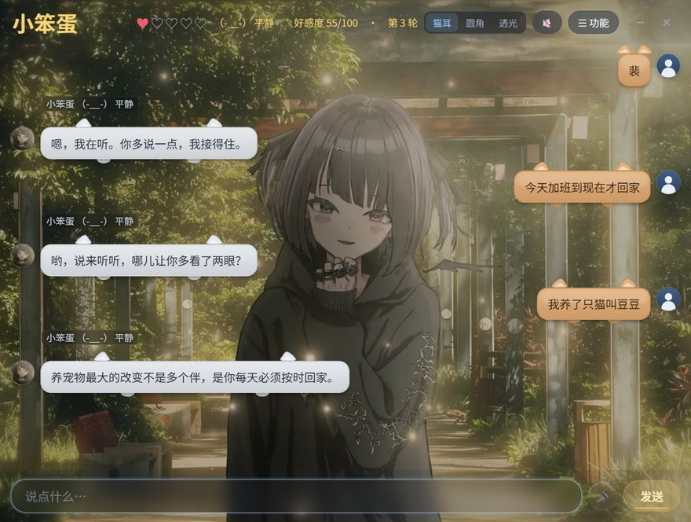
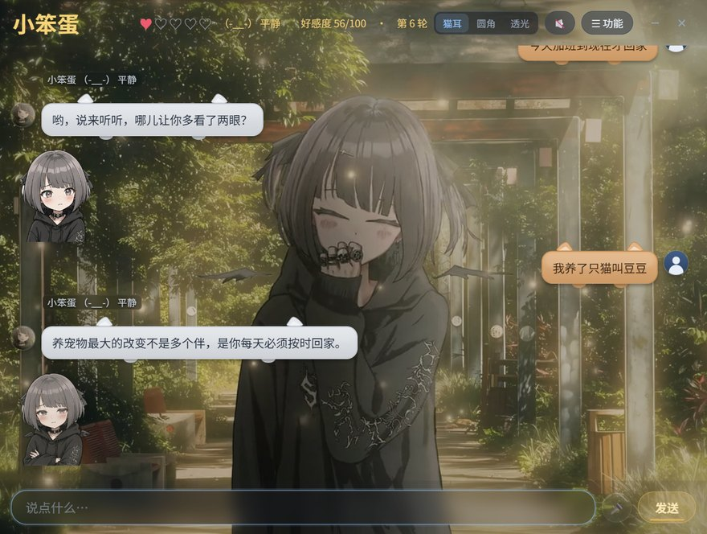
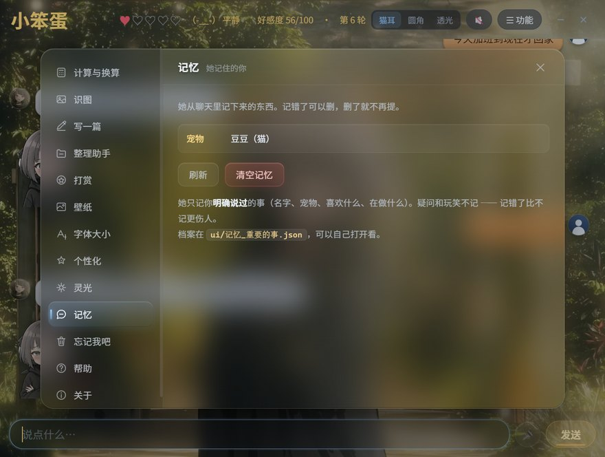
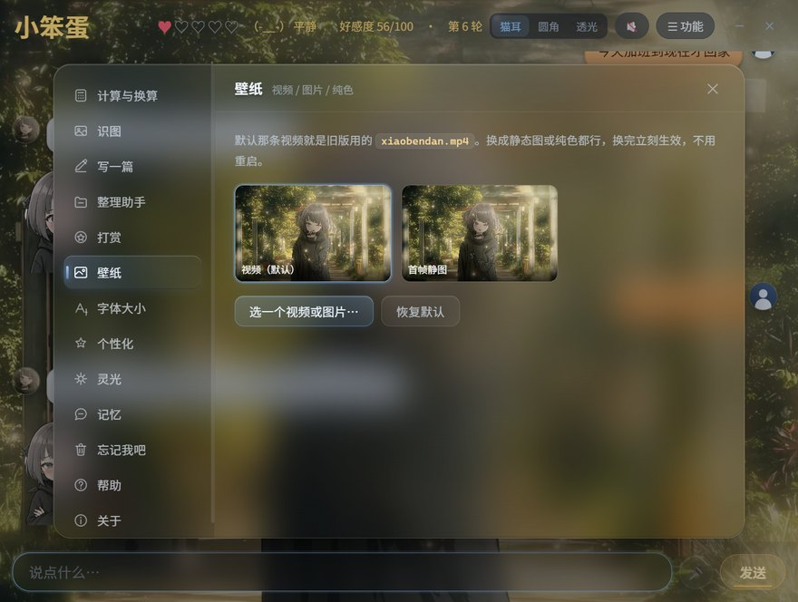
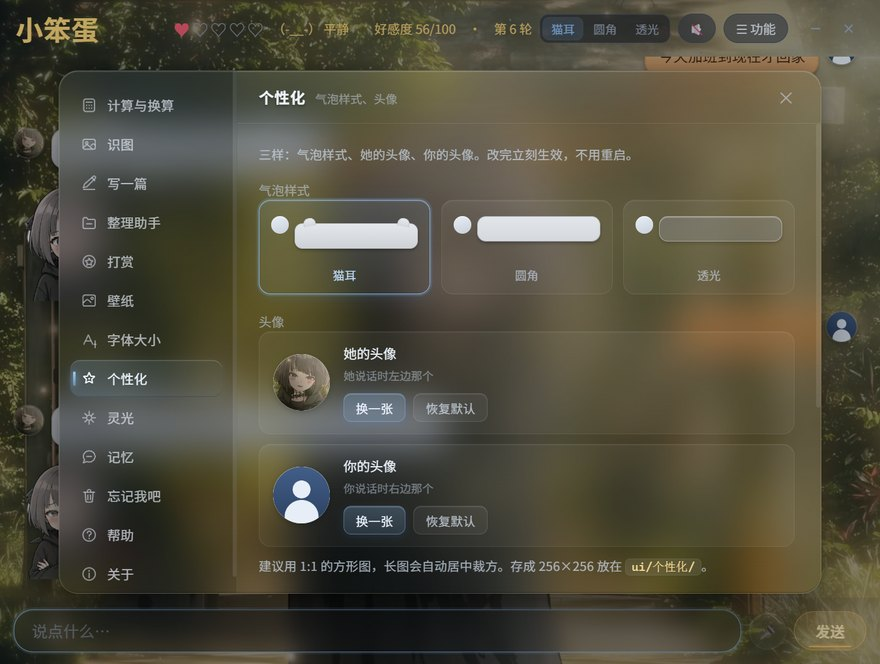
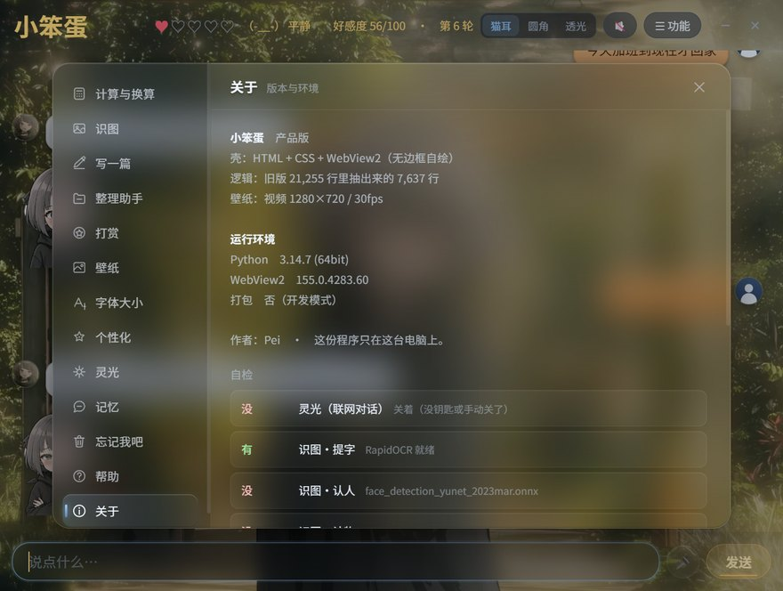

# 小笨蛋 (Little Dummy)

**English** · [中文](README.md)

[](https://github.com/Peijy1226/xiaobendanV2.0.0/releases)
[](LICENSE)
[](#)

A character who lives on your computer. Close the window and she stays in the system tray. Leave her alone long enough and she'll come find you.


## Install

One zip in [Releases](https://github.com/Peijy1226/xiaobendanV2.0.0/releases). Unzip, double-click `小笨蛋.exe`. No Python, no runtime needed.

First launch she asks your name. She remembers it after that.



## Why this exists

I wanted a character who lives on the computer. Not an assistant, not a toolbox.

Every chat app I tried felt like a tool — ask, answer, forget. I wanted: you mention you're working late, and the next day she asks how late you slept.

So memory got the most work; everything else grew around it.



## What she does

**Chat.** Real replies when online, 515 canned lines offline. Time, arithmetic, jokes, unit conversion, OCR, file sorting all work without a key — only free-form conversation needs one.

**Remember you.** Your name, your cat, what you like, what you do, where you live. Across sessions.



**Speak up.** Goes quiet for a while and she'll chime in. Hidden in the tray, she can't talk, so she sends a system notification instead.

**Read aloud, and listen.** The 🔊 in the title bar reads her lines out with edge-tts, splitting on punctuation and downloading while playing — first sound in under a second. The 🎤 next to the input is hold-to-talk, recognized locally by Vosk. No network, nothing uploaded.

**Look at images.** Hand her a picture: she pulls the text out, counts the faces, tells you what the object is. Large images get downscaled before detection, so a 7000-pixel photo won't blow up memory.

**Write.** Narrative, argumentative, expository, letters. Prompts shift by length tier — 300 words and 3000 words aren't the same task.

**Sort files.** Point her at a folder, she groups by file type. Anything outside the whitelist stays put.

**Change the wallpaper.** Video wallpapers keep playing — not a still frame.



## She has expressions

Twenty-nine of them, dispatched by mood. Happy gets the crescent eyes, wronged gets the wet ones, angry puffs her cheeks. Every reply picks one that matches.


## Three bubble styles

Cat ears, rounded, and frosted glass.

The frosted one uses real `backdrop-filter` — the wallpaper moves and it moves with it, not a flat image.

The cat-ear ears are SVG. The path isn't hand-drawn: the 6 control points from the Tkinter version's `create_polygon(smooth=True)` were converted to Béziers via quadratic B-spline — six curves per ear.



## Tuning the UI

Features → Personalize, four sliders:

- **Blur**: 0–80 px
- **Saturation**: 1.0–2.0
- **Brightness**: 0.70–1.40
- **Tint opacity**: 0–0.80

Live while dragging, saved on release. Stored in `ui/个性化/玻璃.txt` as four integers.

The default — blur 22, tint 0.26, brightness 1.12 — came from measuring against the help page text: transparency 5.8, text contrast 20,271. The panel lets the wallpaper through without losing the letters.

## Self-check

The About page lists ten items, so you can see at a glance what works and what's missing. After switching machines or reinstalling, one click tells you what to install.



## Stack

| Layer | What |
|---|---|
| UI | Plain HTML/CSS/JS + WebView2 |
| Window | pywebview 6.2, custom frameless title bar + DWM rounded corners |
| Imaging | OpenCV 5 + onnxruntime + RapidOCR |
| Speech out | edge-tts |
| Speech in | Vosk Chinese small model (42 MB, local, offline) |
| Tray | pystray |
| Packaging | PyInstaller |

**Why not Electron**: an Electron shell starts at 150 MB, and this program's bulk is models and OpenCV anyway. WebView2 ships with Windows — free.

---

# Dev notes

## Layout

```
main.py              Entry: window, DWM rounded corners, tray, idle timer
api.py               Frontend bridge, 53 methods
core/
  luoji.py           Logic, 7,700 lines: chat, mood, memory, wallpaper
  shitu.py           Vision: OCR + face + object
  zhengli.py         File organizer
  xiezuo.py          Writing
  dashang.py         Tips
  tuopan.py          System tray
  zhu_dong.py        Proactive messages + notifications
  yuyin_shuru.py     Speech input (Vosk)
  models/            onnx models (not in repo — run 下载模型.py)
ui/
  index.html
  css/               base / titlebar / chat / input / gongneng
  js/                bridge / bishu / chat / gongneng / input
                     / yuyin (her voice) / yuyin_shuru (your voice)
  素材/              Wallpaper, icons, sample material
  表情/              29 reaction images named by mood
  语料/              515 offline lines
  个性化/            Avatars, bubble preference
  人设.txt           ← her personality
  API.txt            ← your key (gitignored)
下载模型.py
打包.spec
```

Three layers: page (HTML/CSS/JS) → bridge (every `api.py` method maps to one `Qiao.xxx()` on the frontend) → logic (`core/luoji.py`).

## Running locally

```bash
pip install -r requirements.txt
python 下载模型.py
python main.py
```

`--debug` opens F12. `--自检` skips the window and just writes an environment report.

`vendor/` is where I installed pystray / sounddevice / vosk to keep the system site-packages clean. Not required — the code looks in both places. If you want it:

```bash
pip install --target vendor pystray sounddevice vosk srt requests tqdm
```

## Building

```bash
python -m PyInstaller 打包.spec --noconfirm
```

416 MB output. **Most of it isn't my code**:

| What | Size |
|---|---|
| OpenCV (`cv2.pyd`) | 82 MB |
| Vosk Chinese model | 66 MB |
| yolox onnx | 35 MB |

My code is under 1 MB total.

After building, manually `cp -r ui dist/小笨蛋/` — ui isn't bundled into the exe so users can swap wallpapers and add reaction images.

## Changing her personality

`ui/人设.txt`. Restart to apply.

It defines who she is, how she talks, what she won't touch, and how she bluffs when she doesn't know. The prompt is assembled from this file — change one line, change the character.

## Adding lines

`ui/语料/*.txt`, one per line. Loaded into memory at startup; 515 lines take tens of KB, so a few thousand more won't hurt.

## Swapping reaction images

`ui/表情/灵光/` and `ui/表情/离线/`. The filename is the mood: 平静 (calm), 开心 (happy), 兴奋 (excited), 得意 (smug), 委屈 (wronged), 困惑 (confused), 关心 (caring). Extras are picked up automatically, missing ones just don't show.

## Releasing

Tag and push; GitHub Actions builds on a Windows runner and attaches the zip to the Release:

```bash
git tag v2.1.0
git push origin v2.1.0
```

Config lives in `.github/workflows/build.yml`. Takes about 10 minutes.

---

## License

MIT
