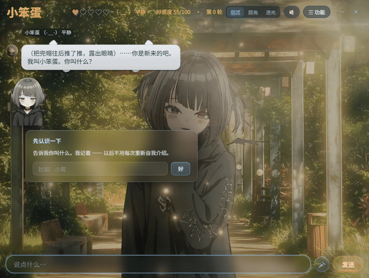
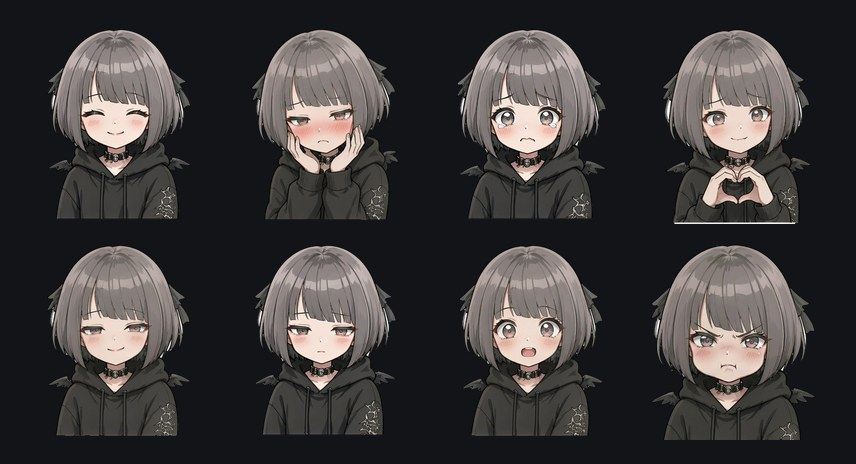

<div align="center">

# 小笨蛋 (Little Dummy)

[](https://github.com/Peijy1226/xiaobendanV2.0.0/releases)
[](LICENSE)
[](#)
[](#)
[](#)


**Her name is Little Dummy. Eighteen years old, silver-grey hair, hood up, living on your computer.**

**Not an assistant, not a robot. Open your laptop and she comes over to talk.**

[Download](https://github.com/Peijy1226/xiaobendanV2.0.0/releases) · [Features](#features) · [Development](#development) · [中文](README.md)

</div>

---

## Preview



## Overview

Little Dummy is a Windows desktop companion application. It stays in the system tray after launch and the chat window can be summoned at any time. Closing the window does not terminate the process — she remains in the background and will speak up on her own after a quiet spell.

The application ships with 515 built-in offline lines covering time, arithmetic, jokes, image recognition and file sorting. With a DeepSeek API key configured, she gains full natural-language conversation.

## Features

| Module | Description |
|---|---|
| **Chat** | Calls a large language model when online; falls back to the local corpus without a key |
| **Long-term memory** | Retains name, pets, preferences, occupation and city across sessions |
| **Proactive messages** | Speaks up after inactivity; delivered as a system notification when hidden |
| **Speech synthesis** | edge-tts, split on punctuation and streamed — first segment under one second |
| **Speech recognition** | Vosk Chinese model, fully local, audio never uploaded |
| **Image recognition** | OCR text extraction, face detection, object detection; large images downscaled automatically |
| **Text generation** | Narrative, argumentative, expository and letter formats, tuned by target length |
| **File sorting** | Groups by extension; directories outside the whitelist are left untouched |
| **Wallpaper** | Static images and video |
| **Interface** | Three bubble styles, font size 12–20, four adjustable panel blur parameters |

## Interface

Three bubble styles ship with the application, alongside a dedicated settings panel:


The frosted bubble uses native `backdrop-filter` — the background shifts as the wallpaper moves, rather than a static overlay.

**Adjustable parameters**

| Parameter | Range | Default |
|---|---|---|
| Blur | 0 – 80 px | 22 px |
| Saturation | 1.0 – 2.0 | 1.26 |
| Brightness | 0.70 – 1.40 | 1.12 |
| Tint opacity | 0 – 0.80 | 0.26 |

Changes apply live and are written to `ui/个性化/玻璃.txt` on release. Defaults were selected by measuring text contrast against the help page: panel transparency 5.8, text contrast 20,271.

## Expressions

Twenty-nine reaction images are dispatched by the current emotional state. Each reply selects one matching its mood, in both online and offline modes.



## Installation

Download `xiaobendan-v2.0.0-win64.zip` from [Releases](https://github.com/Peijy1226/xiaobendanV2.0.0/releases) and double-click `小笨蛋.exe` after extracting.

- No Python installation or runtime required
- Approximately 415 MB extracted
- First launch walks you through setting a name

## API key (optional)

Without a key the application runs in offline mode, covering time, arithmetic, jokes, image recognition and file sorting. For full conversational ability:

1. Register at [platform.deepseek.com](https://platform.deepseek.com) and create an API key
2. Copy `API.示例.txt` to `ui/API.txt`
3. Enter the key after `钥匙=` and restart

Cost is roughly a few tenths of a yuan per thousand messages.

> `ui/API.txt` is listed in `.gitignore` and is never committed.

## Stack

| Layer | Technology |
|---|---|
| UI | Plain HTML / CSS / JavaScript + WebView2 |
| Window | pywebview 6.2, custom title bar + DWM rounded corners |
| Imaging | OpenCV 5 + onnxruntime + RapidOCR |
| Speech out | edge-tts |
| Speech in | Vosk Chinese small model (42 MB, local) |
| Tray | pystray |
| Packaging | PyInstaller |

WebView2 was chosen over Electron: an Electron runtime starts at roughly 150 MB, while this program's bulk comes from models and OpenCV. WebView2 ships with Windows and costs nothing.

---

# Development

## Layout

```
main.py              Entry point: window, DWM rounded corners, tray, idle timer
api.py               Frontend bridge, 53 methods
core/
  luoji.py           Logic layer, ~7,700 lines: chat, mood, memory, wallpaper
  shitu.py           Image recognition: OCR, face, object
  zhengli.py         File sorting
  xiezuo.py          Text generation
  dashang.py         Support page
  tuopan.py          System tray
  zhu_dong.py        Proactive messages and notifications
  yuyin_shuru.py     Speech input (Vosk)
  models/            onnx models (not version-controlled — run 下载模型.py)
ui/
  index.html
  css/               base / titlebar / chat / input / gongneng
  js/                bridge / bishu / chat / gongneng / input
                     / yuyin (speech out) / yuyin_shuru (speech in)
  素材/              Wallpaper, icons, sample material
  表情/              29 reaction images
  语料/              515 offline lines
  个性化/            Avatars, bubble preference
  人设.txt           Character definition
  API.txt            API key (gitignored)
下载模型.py
打包.spec
```

Three layers: page (HTML/CSS/JS) → bridge (each method in `api.py` maps to one `Qiao.xxx()` on the frontend) → logic (`core/luoji.py`).

## Running locally

```bash
pip install -r requirements.txt
python 下载模型.py
python main.py
```

Launch flags: `--debug` opens developer tools; `--自检` skips the window and writes an environment report.

The `vendor/` directory exists to install pystray, sounddevice and vosk separately, keeping the system site-packages clean. It is optional — the code checks both locations. To use it:

```bash
pip install --target vendor pystray sounddevice vosk srt requests tqdm
```

## Building

```bash
python -m PyInstaller 打包.spec --noconfirm
```

Output is approximately 416 MB, almost all of it third-party dependencies:

| Component | Size |
|---|---|
| OpenCV (`cv2.pyd`) | 82 MB |
| Vosk Chinese model | 66 MB |
| yolox onnx model | 35 MB |

The application's own code is under 1 MB.

After building, run `cp -r ui dist/小笨蛋/` manually. The `ui` directory is kept outside the executable so users can swap wallpapers and add reaction images.

## Customization

**Character definition** — edit `ui/人设.txt`, restart to apply. The file defines identity, speaking style, off-limits topics and how unknown questions are handled; the prompt is assembled from it.

**Offline corpus** — `ui/语料/*.txt`, one line each. Loaded into memory at startup; the current 515 lines occupy tens of KB.

**Reaction images** — `ui/表情/灵光/` and `ui/表情/离线/`, named by mood (平静, 开心, 兴奋, 得意, 委屈, 困惑, 关心). Added files are picked up automatically; missing ones are simply not shown.

**Wallpaper** — drop files into `ui/素材/壁纸/`.

---

## License

MIT
